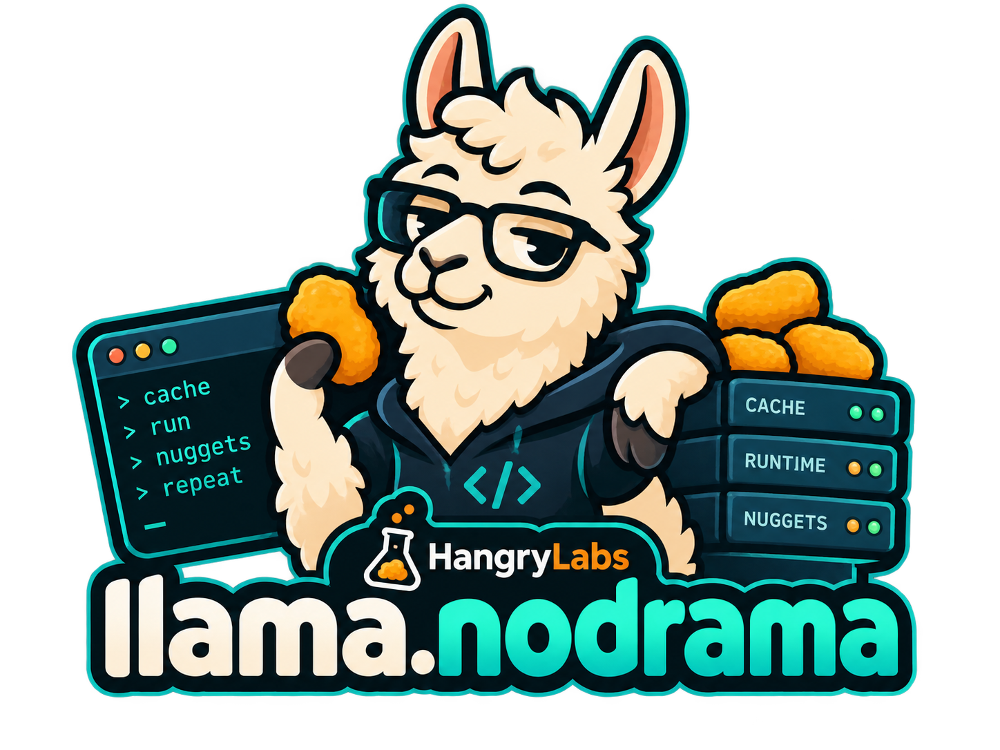
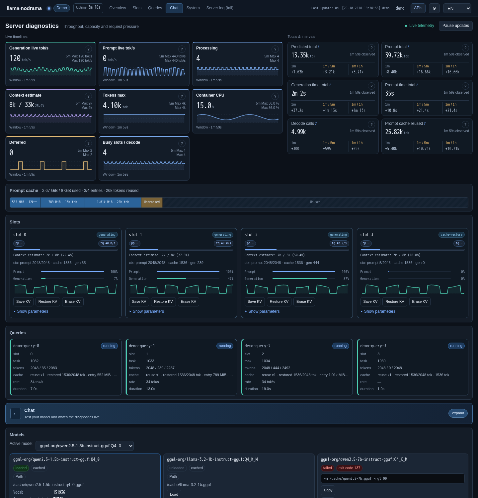

<p align="center">
  
</p>

**Read this in:** [🇺🇸 English](../../README.md) | [🇰🇷 한국어](README.ko-KR.md) | [🇯🇵 日本語](README.ja-JP.md) | [🇨🇳 简体中文](README.zh-CN.md) | [🇪🇸 Español](README.es-ES.md)

Development version **v0.6.0-SNAPSHOT**. [Version history](../../README.md#version-history).

`llama.nodrama` is a small Go dashboard for operating `llama.cpp` servers. It exists because running `llama.cpp` with multiple slots should not feel like guesswork. The goal is simple: point it at your llama, get a clear visual overview, and have no drama.

The dashboard focuses on the things that are hard to see from raw logs alone: slot activity, query flow, queueing, token throughput, cache reuse, and timelines of what changed while the server was under load. It serves a browser UI and a typed backend API that normalize `llama.cpp` metrics, slots, requests, suggestions, and historical values into one live view.

This is especially useful when running on a budget machine where concurrency and KV cache behavior matter. If you need several clients to share limited compute and memory, balancing slots, cache reuse, prompt processing, and generation speed requires visibility. `llama.nodrama` is meant to make that operational picture obvious without turning monitoring itself into another project.

## UI Preview



## Install

Linux and macOS:

```sh
curl -fsSL https://raw.githubusercontent.com/hangry-labs/llama.nodrama/main/install.sh | sh
```

Windows PowerShell:

```powershell
irm https://raw.githubusercontent.com/hangry-labs/llama.nodrama/main/install.ps1 | iex
```

The Windows installer copies `llama-nodrama.exe` to a user-local install directory and adds that directory to the user PATH. The current PowerShell session is updated too, so `llama-nodrama --help` should work immediately after install.

Both installers use the newest GitHub Release by default. To pin a version:

```sh
LLAMA_NODRAMA_VERSION=v0.1.0 sh ./install.sh
```

```powershell
$env:LLAMA_NODRAMA_VERSION = "v0.1.0"; .\install.ps1
```

## Run

Start `llama-server` with the endpoints the dashboard needs:

```sh
llama-server --metrics
```

Then run the dashboard:

```sh
llama-nodrama --server http://127.0.0.1:8080 --listen :39080
```

Open `http://127.0.0.1:39080`.

`llama.nodrama` does not auto-discover `llama.cpp` servers yet. Point it at the specific deployment you want to monitor with `--server`; if `llama-server` runs on the same machine with the usual port, the default is already `http://127.0.0.1:8080`.

You can also change runtime settings from the UI settings button after startup: server URL, log path, backend poll interval, and upstream timeout. Changing the server or log path resets collected dashboard history so old and new targets do not mix. The listen address and raw proxy routes are startup-only settings.

## Build From Source

```sh
cd nodrama
go test ./...
go build -o llama-nodrama .
```

Useful flags:

```text
--server     llama.cpp server base URL, default http://127.0.0.1:8080
--listen     dashboard listen address, default :39080
--log        optional llama.cpp log file path for /api/logs/tail
--poll       polling interval, default 1s
--raw-proxy  expose selected raw llama.cpp proxy routes for debugging
--timeout    upstream request timeout, default 5s
--update     print repository and latest release links, then exit
--version    print build version and exit
```

The version label in the dashboard top bar links to the project repository. The backend periodically checks the newest GitHub Release; when a newer release exists, the version label highlights and links directly to that release.

Runtime logs use explicit levels (`INFO`, `WARN`, `ERROR`). Set `LLAMA_NODRAMA_DEBUG=1` to include detailed endpoint probe logs.

## Privacy

`llama.nodrama` runs locally and does not collect, sell, or transmit user data to Hangry Labs. See [PRIVACY.md](../../PRIVACY.md) for the full privacy statement.

## Releases

Published releases provide Linux, macOS and Windows binaries for amd64 and arm64, plus checksums. The installers use the latest published stable release by default. Branch CI artifacts are development builds.

[Version history and published downloads](../../README.md#version-history) · [Release preparation and publication guide](../RELEASING.md).

## License

The project source code and documentation are licensed under the [MIT License](../../LICENSE). Logos, mascots, badges, icons, and other brand artwork are excluded from MIT and governed by [BRAND_ASSETS.md](../../BRAND_ASSETS.md). Required third-party license text and attribution are recorded in [THIRD_PARTY_NOTICES.md](../../THIRD_PARTY_NOTICES.md). The release workflow includes all three files in newly built archives.
